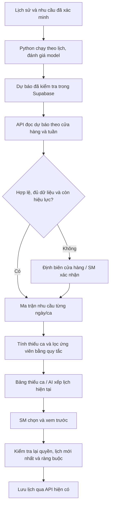

# Rà soát thiết kế AI Smart Scheduler

Ngày: 05/10/2026. Đối chiếu mã nguồn tại commit `165b3841`.

Trạng thái: đề xuất kỹ thuật để chốt phạm vi, chưa có migration, model hoặc dịch vụ ML mới được triển khai. Tài liệu gốc: [ML_Smart_Scheduler_Architecture.md](./ML_Smart_Scheduler_Architecture.md).

## 1. Phạm vi phù hợp với ứng dụng hiện tại

Giữ hướng tách dự báo nhu cầu khỏi thuật toán xếp người và để SM xác nhận trước khi lưu. Tích hợp vào màn hình xếp lịch hiện có. Ưu tiên một luồng hoạt động được khi chưa có model hoặc model gặp lỗi.

| Thành phần | Hiện trạng trong repo | Hướng xử lý |
| --- | --- | --- |
| Định biên | `stores.staffing`, `stores.demand`, `buildStaffingByDay`, `demandToMatrices` | Giữ làm phương án mặc định; thống nhất nguồn định biên khi gắn dự báo |
| Xếp lịch | `generateAISchedule` nhận `requiredMatrixByDay` | Nối ma trận nhu cầu mới vào đầu vào này; giữ hàm tính toán thuần, không nhét truy vấn DB vào thuật toán |
| Thiếu ca | `calculateStaffingGap`, `StaffingGapTable.jsx` | Mở rộng bảng hiện tại, bổ sung nguồn và thời điểm của nhu cầu |
| Xếp hạng ứng viên | `rankGapCandidates`, `suggestGapCandidates` | Tái sử dụng, rà soát điều kiện cứng trước; chưa cần `/score-staff` Python |
| Ca đêm / chi viện | Có `NIGHT_READY`, kiểm tra kèm người cứng, tuần liền trước/sau và cửa hàng quản lý | Giữ các ràng buộc này trong bước đề xuất và kiểm lại khi áp dụng |
| Xem trước / lưu | `AISchedulerModal` và `applyAiSchedule` | Giữ kiểm tra lịch nguồn, khóa tuần, quyền và lưu có rollback |

## 2. Những điểm phải sửa trong bản thiết kế trước khi huấn luyện

### Nhãn học: đã xếp bao nhiêu người khác với cần bao nhiêu người

`actual_staff_count` phản ánh nhân lực đã bố trí/đi làm. Nếu cửa hàng thường xuyên thiếu người, học trực tiếp nhãn này sẽ sao chép tình trạng thiếu người. Chưa thể gọi kết quả đó là nhu cầu nhân sự tối ưu.

Phân biệt các dữ liệu sau:

- `scheduled_staff_count`: số người được xác nhận trên lịch.
- `worked_staff_count`: số người thực sự có mặt; chỉ xác lập khi nguồn chấm công đủ thông tin ca và cửa hàng làm việc.
- `required_staff_count`: định biên SM xác nhận hoặc được suy ra từ khối lượng công việc và quy tắc năng suất đã thống nhất.
- `transactions`, `customers`, `sales`: quan sát khối lượng công việc theo ngày/ca, có nguồn và thời điểm ghi nhận.

Hiện `attendance` lưu `emp_id`, `work_date`, `actual_hours`, `note`, chưa có ca và cửa hàng thực tế. Không thể chỉ đếm bản ghi công rồi khẳng định số người thực làm từng ca. Phép hưởng lương cũng không đồng nghĩa với có mặt tại cửa hàng.

Chưa có xác nhận về dữ liệu POS/Excel theo ca. Trong thời gian chờ, thiết kế dựa trên giả định chỉ có lịch và chấm công; dùng định biên hiện tại hoặc SM xác nhận làm nguồn nhu cầu. Dữ liệu `stores.demand` đang là cấu hình ngày thường/cuối tuần, không tự tạo thành lịch sử giao dịch theo ca.

### Dữ liệu giả chỉ phục vụ kiểm thử

Fixture có thể kiểm tra đọc/ghi, định dạng và giao diện. Không dùng hàng nghìn dòng sinh ngẫu nhiên để tuyên bố model học được nhu cầu thật của GS25. Bỏ `weather_condition` ở bản đầu khi chưa có nguồn thời tiết thật và nguồn dự báo tương ứng tại thời điểm chạy model.

### Điểm ứng viên và độ tin cậy dự báo là hai khái niệm riêng

- Điểm xếp hạng ứng viên có thể hiển thị `92/100 điểm ưu tiên` khi có công thức, phiên bản và lý do rõ ràng. Không gọi đây là xác suất nhận ca hoặc tỷ lệ phù hợp đã được kiểm chứng.
- `confidence_score` của dự báo không được đặt cố định hoặc suy ra từ điểm ứng viên. Bản đầu có thể bỏ trường này, hiển thị nguồn, độ mới và trạng thái đủ/chưa đủ dữ liệu.
- Chưa có tọa độ hoặc thời gian di chuyển được xác minh thì không hiển thị khoảng cách như `1,5 km` và không cộng điểm khoảng cách giả.

## 3. Luồng triển khai đề xuất

Bản đầu dùng Python chạy theo lịch để tạo sẵn dự báo. Frontend chỉ đọc Supabase. FastAPI chỉ cần bổ sung khi thực sự cần kích hoạt tác vụ từ hệ thống khác; không mở endpoint train công khai. Nếu có API sau này, train chạy dưới dạng job có xác thực, khóa chống chạy trùng và giới hạn tài nguyên.

Thứ tự chọn nhu cầu: điều chỉnh SM hợp lệ → dự báo đạt điều kiện sử dụng → định biên hiện có. Các điều chỉnh đều phải qua giới hạn vận hành; model không tự nới rule về giờ, nghỉ hoặc kỹ năng.

## 4. Hợp đồng dữ liệu cần chốt

### Nguồn huấn luyện

Một quan sát phải có khóa cửa hàng, ngày làm việc, mã ca và nguồn dữ liệu. Ca `22-6` được gắn vào ngày bắt đầu theo `Asia/Ho_Chi_Minh`. Xác định rõ mỗi dòng là số người trong cả ca hay mức bao phủ ở từng khoảng giờ; không quy mọi ca ngắn thành một ca 8 giờ.

Lưu hoặc dựng từ snapshot cửa hàng thực tế tại thời điểm làm việc: `covering_store` có ưu tiên so với cửa hàng gốc. Không dùng `employees.dept` hiện tại để suy lại toàn bộ lịch sử sau khi có điều chuyển. Lịch đăng ký/chưa xác nhận, OFF, ca chưa xếp và bản ghi chưa đủ dữ liệu phải được phân biệt. Giữ lịch sử nhân sự/cửa hàng đã ngưng hoạt động khi tổng hợp quá khứ.

Chỉ tạo `ml_demand_training_data` khi đã thống nhất nhãn và nguồn có đủ dữ liệu. Nguồn train đặt trong schema không công khai hoặc thu hồi quyền đọc của `anon`/`authenticated`. Nếu có view cho frontend, cấu hình `security_invoker` theo phiên bản PostgreSQL và kiểm thử RLS trên bảng gốc.

### Cache dự báo `ml_shift_predictions`

Đề xuất tối thiểu:

| Trường | Ý nghĩa |
| --- | --- |
| `store_id`, `shift_date`, `shift_code` | Khóa duy nhất của dự báo đang phục vụ; dùng mã ca đã có như `6-14`, hỗ trợ ca ngắn, không tạo enum MORNING/NIGHT song song |
| `predicted_demand` | Số nguyên không âm, được kiểm tra giới hạn hợp lý trước khi công bố |
| `source` | Phân biệt dự báo model và baseline khi có sử dụng baseline lưu sẵn |
| `model_version` | Truy nguyên model/baseline đã tạo kết quả |
| `training_cutoff` | Mốc dữ liệu cuối cùng được phép dùng khi train |
| `generated_at`, `expires_at` | Độ mới và hiệu lực để frontend quyết định fallback |
| `run_id` | Xác định cùng một lần sinh dự báo, tránh trộn phiên bản trong tuần |

Đây là cache phục vụ hiện tại: dùng unique `(store_id, shift_date, shift_code)` và upsert idempotent. Metadata và kết quả đánh giá model lưu cùng artifact của job; chưa cần hệ thống quản lý model riêng. Công bố cả tập dự báo của lần chạy theo giao dịch để tránh tuần cập nhật dở dang.

RLS: tài khoản người dùng chỉ đọc các cửa hàng được phép; worker riêng được ghi. Khóa service role chỉ tồn tại trong môi trường worker. API frontend đi qua barrel `services/api.js`, không gọi Supabase trực tiếp từ component. Thiếu bảng hoặc không có dự báo phải quay về định biên cũ; lỗi khác cần được quan sát và báo trạng thái thích hợp.

## 5. Khớp nối với nghiệp vụ hiện có

1. Giữ quy ước hiện tại `calculateStaffingGap.gap = đã xếp - cần`; số thiếu để hiển thị là `Math.max(0, -gap)`. Không đảo dấu và làm hỏng các nơi đang dùng.
2. Đếm người làm tại cửa hàng đích, gồm chi viện đến, loại người đã đi chi viện nơi khác. Không đếm ca đăng ký như ca đã xác nhận.
3. Giữ nguyên `employee.dept`; khi chi viện ghi `{ shift, covering_store }` vào ô lịch.
4. Tách loại ứng viên không hợp lệ khỏi bước chấm điểm. Kiểm tra hoạt động, quyền quản lý cả hai cửa hàng, khóa tuần, ca trùng, lịch rảnh, OFF cần đồng ý, kỹ năng và nghỉ giữa ca.
5. Tái sử dụng `SCHEDULE_RULES`/`DECISION_RULES`. Các con số 23h, 91h, 48h, 11h là quy tắc cấu hình dự án; không tự diễn giải thành kết luận pháp lý.
6. Nạp đủ tuần trước/sau và toàn bộ kỳ công 26–25 để tính giờ. Phải rà soát riêng `aiDecisionEngine.js`: phép cộng giờ tháng hiện dùng tiền tố tháng lịch; cần thống nhất kỳ công trước khi mở rộng gợi ý tự động.
7. Chưa đủ lịch sử để kiểm tra ràng buộc thì đánh dấu chưa đủ dữ liệu và chặn áp dụng tự động, không tự coi giờ còn lại bằng 0.
8. Khi bấm thêm người, kiểm tra lại dựa trên lịch mới nhất và dữ liệu đã thay đổi từ lúc tạo đề xuất. Tránh hai thao tác liên tiếp gán cùng người hoặc vượt giờ.

Không xây một drawer thứ hai ở bản đầu. Trong `StaffingGapTable` chỉ bổ sung: ngày/ca, cần bao nhiêu, đã xếp bao nhiêu, thiếu bao nhiêu, nguồn định biên, 1–2 ứng viên và lý do. Tận dụng luồng xác nhận hiện tại.

## 6. Đánh giá model và điều kiện mở sử dụng

So sánh với một baseline đơn giản trên cùng tập dữ liệu, ví dụ định biên hiện tại và trung vị các ngày/ca tương đương. Chia dữ liệu theo thời gian: train quá khứ, đánh giá trên các tuần sau đó; giữ các dòng cùng ngày/tuần của các cửa hàng trong cùng phía của ranh giới chia tập. Không xáo trộn các dòng tương lai vào tập train.

Đánh giá sai số tuyệt đối và mức dự báo thiếu theo cửa hàng/ca; báo số mẫu để tránh kết luận từ nhóm quá ít quan sát. Chọn ngưỡng chấp nhận với người vận hành trước khi xem kết quả cuối. Chạy đối chiếu âm thầm, chưa điều khiển định biên, đến khi có bằng chứng tốt hơn baseline. Không cam kết mức chính xác hoặc số ngày thu thập dữ liệu khi chưa khảo sát nguồn thực tế.

## 7. Roadmap thu gọn

| Giai đoạn | Kết quả bàn giao | Ước lượng công kỹ thuật |
| --- | --- | --- |
| A — Chốt dữ liệu và quy tắc | Nguồn/nhãn rõ, kiểm tra kỳ công, baseline và phép đếm ca/chi viện thống nhất | 1–2 ngày |
| B — Tích hợp có fallback | Migration cache dự báo + RLS, API/adapter ma trận, bổ sung vào bảng thiếu ca, test quyền và lịch thay đổi | 2–3 ngày |
| C — Python chạy theo lịch | Một model LightGBM, chia tập theo thời gian, báo cáo so với baseline, ghi dự báo idempotent | 2–4 ngày sau khi dữ liệu thật đạt yêu cầu |
| D — Chạy đối chiếu và mở dần | Đo sai số thực tế, SM đánh giá, bật theo cửa hàng, có cách quay về định biên cũ | Phụ thuộc số kỳ quan sát |

Các mốc là ước lượng, chưa gồm thời gian thu thập/làm sạch dữ liệu. Hoãn FastAPI thường trực, `/score-staff`, dashboard ML riêng, thời tiết giả và phần trăm tự tin chưa hiệu chỉnh.

## 8. Kiểm tra bộ dữ liệu giả lập bổ sung ngày 05/10/2026

Đã đọc `scripts/generate_ml_data.js` và kiểm tra CSV hiện có, không chạy lại generator hoặc ghi đè dữ liệu người dùng. Báo cáo máy đọc được lưu ở `artifacts/ml-mock-review/validation.json` (artifact local, được gitignore).

- Đủ 540 dòng, 180 ngày từ 01/04/2026 đến 27/09/2026; mỗi ngày đủ 3 ca, không trùng khóa, không thiếu trường, thứ/ngày cuối tuần khớp lịch.
- Có 4 ngày gắn cờ lễ và 12 ngày thời tiết cực đoan. Đây là kết quả ngẫu nhiên của fixture, không phải lịch lễ/thời tiết đã xác minh.
- Doanh thu trung bình ngày thường: 15.430.699 đồng; cuối tuần: 8.735.030 đồng. Các mức 16 triệu/9 triệu và đặc tính khu công sở/trường học trong script là giả định, chưa được người dùng xác nhận là dữ liệu thực tế VN0485.
- Hàm định biên gốc tạo 187 ca cần 2 người, 158 ca cần 3 người và 195 ca cần 4 người. Không có ca nào đạt ngưỡng lý tưởng 5 người (doanh thu ca cao nhất 8.250.768 đồng, dưới ngưỡng 9 triệu).
- Sau thêm nhiễu: 438 ca giữ nguyên, 38 ca bớt một người, 64 ca thêm một người. Tất cả 23 nhãn 5 người đều xuất phát từ nhiễu xếp thừa. Điều kiện không bớt khi đã có 2 người làm nhiễu không đối xứng.
- `shift_foot_traffic` hoàn toàn suy ra từ doanh thu chia 45.000, không phải quan sát khách hàng độc lập.

Kết luận kiểm tra: fixture phù hợp để thử định dạng và luồng phần mềm. Chưa có kết quả huấn luyện hoặc bằng chứng dự báo nhân sự thật. Model đánh giá tốt trên fixture này chủ yếu thể hiện khả năng học lại quy tắc doanh thu do chính generator đặt ra.

Cải tiến generator đề xuất: thêm seed, tham số ngày bắt đầu/đầu ra, nhãn `is_synthetic`, tách `ideal_staff_count` và `assigned_staff_count`; thêm các tình huống biên có chủ đích thay vì dựa hoàn toàn vào ngẫu nhiên. Quy đổi mã ca về enum hiện có ở ranh giới import. Không dùng doanh thu thực tế hoặc thời tiết thực tế của tuần tương lai làm đầu vào dự báo tuần đó; sử dụng dữ liệu trễ hoặc dự báo có sẵn tại thời điểm chạy.

Đã đọc thêm `docs/sql_ml_schema.sql` xuất hiện cùng generator. Các policy `TO authenticated USING (true)` cho phép mọi tài khoản đã đăng nhập đọc dữ liệu, chưa thể hiện giới hạn Admin/SM/cửa hàng như comment. Phải sửa quyền trước khi dùng dữ liệu thật; bảng train không nên mở cho frontend. File cũng dùng tên `ml_demand_predictions`, khác `ml_shift_predictions` trong thiết kế ban đầu, và trộn hai ý nghĩa nhãn trong `actual_staff_count`. Cần thống nhất hợp đồng trước khi viết API. Chưa chạy SQL này lên Supabase.

## 9. Kiểm tra phiên bản generator có seed và SQL sửa đổi

Đã thực thi `node scripts/generate_ml_data.js` trong 100 tiến trình mới tại root repo theo yêu cầu. CSV root đã được tạo lại. Báo cáo: `artifacts/ml-mock-review/seeded-validation.json`.

Kết quả trên máy hiện tại:

- 100 lần chạy có cùng SHA-256: `45e52e249cc15ff7fa4adc78aaf060baa281b6b93b73c00b22b577da5e53f6ed`.
- 540 dòng / 180 ngày, không trùng khóa, không thiếu trường, toàn bộ `is_mock_data=true`.
- `ideal_staff_count` khớp hàm định biên: 187 ca cần 2 người, 127 ca cần 3 người, 225 ca cần 4 người, 1 ca cần 5 người.
- `assigned_staff_count`: 458 ca không đổi, 25 ca giảm một người, 57 ca tăng một người. Ca lý tưởng 5 người duy nhất được giả lập xếp thành 6 người. Tách nhãn đã đúng nhưng cần thêm fixture biên có chủ đích để kiểm thử nhánh 5 người; không tăng dữ liệu giả rồi diễn giải thành bằng chứng về độ chính xác thực tế.

Kiểm tra độc lập ở ba múi giờ (file riêng dưới artifacts): UTC và Asia/Ho_Chi_Minh cho cùng hash; America/Los_Angeles cho hash khác, cả 540 dòng có `day_of_week` lệch so với `shift_date`. Nguyên nhân là trộn `new Date('2026-04-01')`/`toISOString()` (UTC) với `getDay()`/`setDate()` (giờ địa phương). Nên dùng UTC nhất quán cho lịch giả lập: `getUTCDay()`, `getUTCDate()`, `setUTCDate()`.

SQL mới chưa đủ điều kiện triển khai:

1. JWT hook trong `supabase/migrations/20260921000000_p03_custom_jwt_hook.sql` ghi `app_role` và `app_dept`, không ghi `store_id`. Giá trị role cũng lấy từ hồ sơ thực tế. Policy mới không tương thích đầy đủ với SM nhiều cửa hàng / OFC / Admin của repo. Nên dùng `public.can_manage_store(store_id)` đã có và kiểm thử từng vai trò.
2. `FOR ALL` áp dụng cả đọc và ghi khi vai trò có quyền thao tác bảng, trong khi yêu cầu frontend là đọc dự báo. Dùng policy `FOR SELECT TO authenticated` cho dữ liệu phục vụ; chỉ worker được ghi. Lịch sử train không tự mở cho mọi SM.
3. Nếu từng chạy SQL cũ, policy mở `Enable read for authenticated users` còn trong DB vì SQL mới không drop policy cũ. Các policy permissive kết hợp OR nên policy mới không thu hẹp được policy cũ. Cần migration loại bỏ các policy cũ đã biết và kiểm tra quyền hiệu lực.
4. `CREATE TABLE IF NOT EXISTS` không chuyển bảng đã tồn tại từ `actual_staff_count` sang hai nhãn mới. Cần đường migration có `ALTER TABLE` và quy tắc backfill; không tự coi nhãn thực tế cũ là nhãn lý tưởng. `CREATE POLICY` hiện cũng chưa chạy lại an toàn khi policy đã tồn tại.

Ghi chú về lag features là đúng hướng. Khi có Python, phải tính riêng theo cửa hàng/ca, loại quan sát hiện tại khỏi cửa sổ và áp dụng mốc dữ liệu có sẵn khi dự báo cả tuần. Không dùng nội suy lấy thông tin từ tương lai. Chưa có pipeline Python để xác nhận việc này bằng kiểm thử.

Phạm vi lần kiểm tra: tạo lại CSV theo yêu cầu, lưu báo cáo và đối chiếu source SQL/JWT. Chưa sửa generator/SQL của người dùng hoặc chạy migration lên Supabase.

## 10. Worker local đã chạy — 05/10/2026

Đã thêm `backend-ml/` theo yêu cầu tiếp tục FastAPI + LightGBM. Xem [hướng dẫn worker](../backend-ml/README.md). Worker chỉ chấp nhận dữ liệu mock, train bằng `ideal_staff_count`, đóng băng features trước thứ Hai của từng tuần và giữ bốn tuần cuối làm holdout. Lưu model native, lịch sử, metadata/checksum và báo cáo; API chỉ đọc kết quả cho tuần ngay sau lịch sử, trả đúng mã ca của app.

Generator hiện đã được người dùng sửa sang UTC nhất quán. Kiểm tra lại ở UTC, Asia/Ho_Chi_Minh và America/Los_Angeles đều cho SHA256 `45e52e249cc15ff7fa4adc78aaf060baa281b6b93b73c00b22b577da5e53f6ed`; phát hiện timezone ở phần trước đã được khắc phục.

Kết quả local: 20 tests đạt, dependency check đạt, HTTP API trả 21 dự báo thành công. MAE LightGBM 0,051848 so với baseline trung vị lịch sử 0,047619 trên 84 ca cuối: ML chưa vượt baseline. Chưa có bằng chứng cải thiện nhu cầu nhân sự thật; không thay scheduler đang chạy bằng model mock. CSV kết thúc 27/09/2026 nên run hiện tại chỉ dự báo tuần 28/09–04/10/2026.

Các vấn đề SQL/RLS nêu trên vẫn cần xử lý trước bước tích hợp Supabase. Phiên này chưa triển khai migration, worker lên mạng hoặc thay frontend.

## Tài liệu kỹ thuật đã đối chiếu

- [scikit-learn: TimeSeriesSplit](https://scikit-learn.org/stable/modules/generated/sklearn.model_selection.TimeSeriesSplit.html): chia tập theo thứ tự thời gian, tránh train bằng tương lai rồi đánh giá quá khứ.
- [scikit-learn: Data leakage](https://scikit-learn.org/stable/common_pitfalls.html#data-leakage): đặc trưng phải có tại thời điểm dự báo, fit preprocessing chỉ trên tập train.
- [Supabase: RLS và view](https://supabase.com/docs/guides/database/postgres/row-level-security): bảo vệ view và giới hạn quyền theo vai trò.
- [PostgreSQL: CREATE POLICY](https://www.postgresql.org/docs/current/sql-createpolicy.html) và [Row Security Policies](https://www.postgresql.org/docs/current/ddl-rowsecurity.html): phạm vi ALL/SELECT, quyền bảng và cách kết hợp policy permissive.
